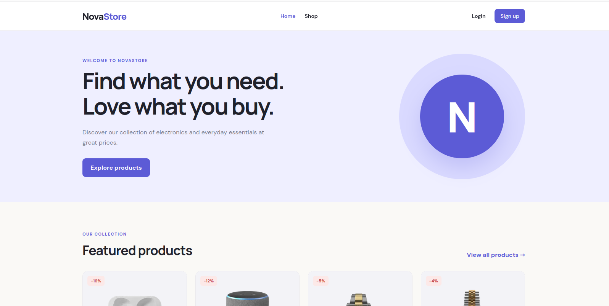
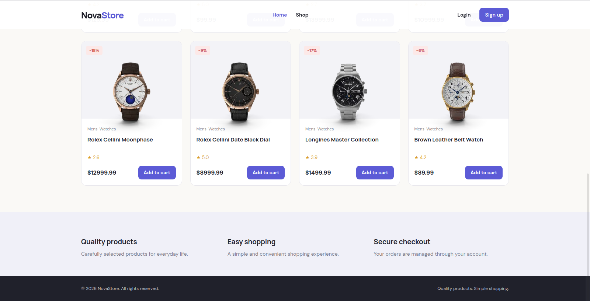
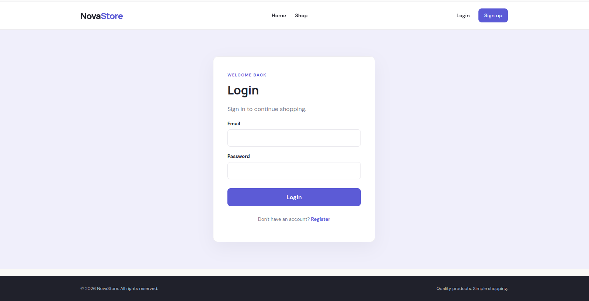
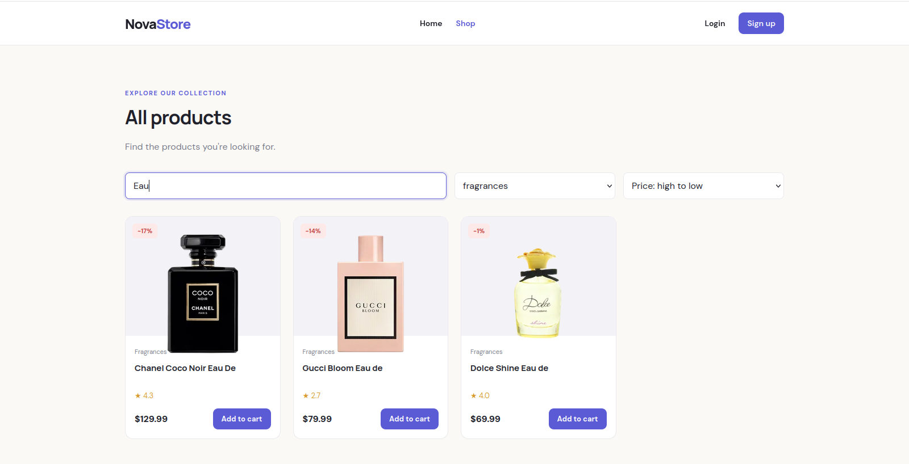
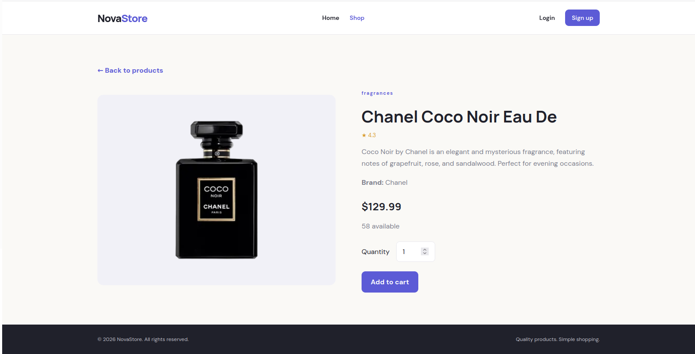
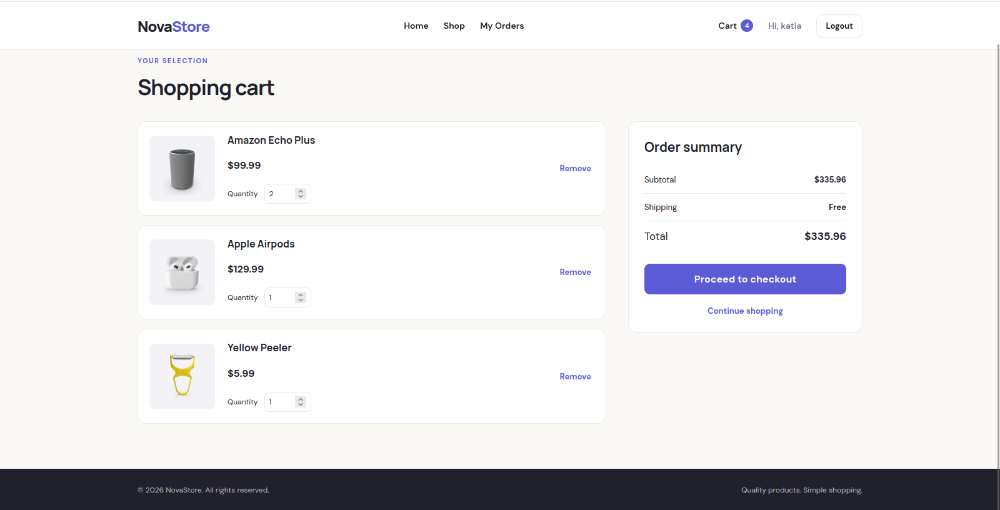
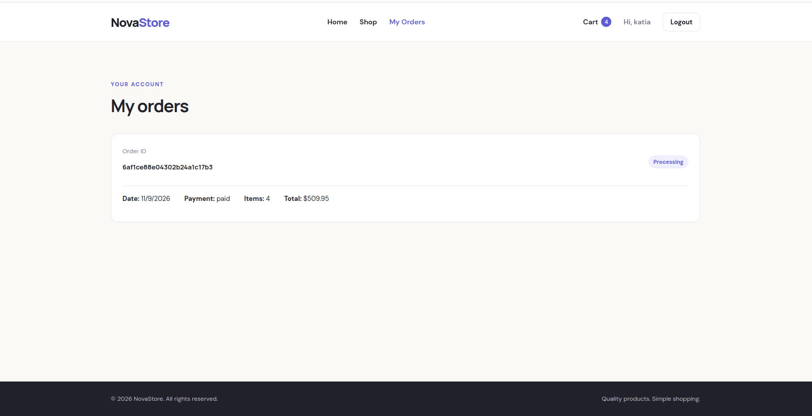
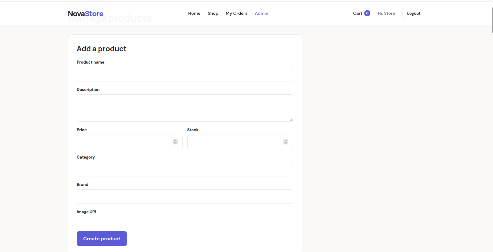
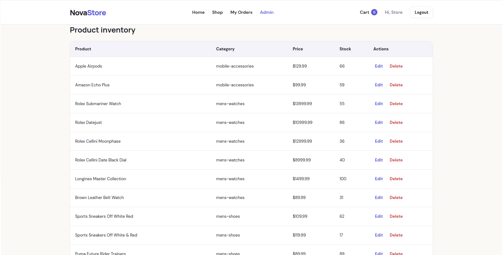

# GMC NovaStore

A full-stack e-commerce application for browsing and purchasing products. NovaStore is built with the MERN stack and includes product management, user authentication, shopping cart functionality, and order processing.

## Screenshots

### Home Page




### Login Page



### Products Page



### Product Details



### Shopping Cart



### Checkout


### Orders



### Admin Product Management




## Features

### Customer Features

- Browse the product catalog.
- Search and filter products by category.
- Sort products and navigate through product pages.
- View detailed product information.
- Register and log in securely.
- Add products to a shopping cart.
- Update product quantities and remove items.
- Complete the checkout process.
- View previous orders.

### Admin Features

- Access protected admin functionality.
- Add new products.
- Edit existing products.
- Delete products.
- Manage the product catalog.

### Backend Features

- RESTful API built with Express.js.
- MongoDB database integration using Mongoose.
- JWT-based authentication.
- Password hashing with bcrypt.
- Role-based access control.
- Product, cart, and order management.
- Centralized error handling.

## Technologies Used

### Frontend

- React
- Vite
- React Router
- Context API
- Axios
- CSS

### Backend

- Node.js
- Express.js
- MongoDB
- Mongoose
- JSON Web Tokens (JWT)
- bcryptjs

### External API

- [DummyJSON Products API](https://dummyjson.com/docs/products) — used as a source of sample product data.

## Project Structure

```text
NovaStore/
├── backend/
│   ├── config/
│   ├── controllers/
│   ├── middleware/
│   ├── models/
│   ├── routes/
│   ├── scripts/
│   ├── services/
│   ├── utils/
│   ├── .env.example
│   ├── package.json
│   └── server.js
│
├── frontend/
│   ├── public/
│   ├── src/
│   │   ├── api/
│   │   ├── components/
│   │   ├── context/
│   │   ├── pages/
│   │   ├── App.jsx
│   │   └── index.css
│   ├── .env.example
│   └── package.json
│
├── .gitignore
└── README.md
```

## Getting Started

Follow these instructions to run NovaStore locally.

### Prerequisites

Make sure you have installed:

- Node.js and npm
- MongoDB
- Git

### 1. Clone the repository

```bash
git clone https://github.com/KatiaGhezali/GMC-ecommerce-mern
cd NovaStore
```

### 2. Set up the backend

```bash
cd backend
npm install
```

Create a `.env` file inside the `backend` directory:

```env
PORT=5000
MONGODB_URI=mongodb://127.0.0.1:27017/ecommerce
JWT_SECRET=your_jwt_secret
CLIENT_URL=http://localhost:5173
```

Replace `your_jwt_secret` with a secure random secret.

Start the backend:

```bash
npm run dev
```

The API will run at:

```text
http://localhost:5000
```

### 3. Set up the frontend

Open a second terminal from the project root:

```bash
cd frontend
npm install
```

Create a `.env` file inside the `frontend` directory:

```env
VITE_API_URL=http://localhost:5000/api
```

Start the frontend:

```bash
npm run dev
```

The application will be available at:

```text
http://localhost:5173
```

## Environment Variables

| Variable       | Description                               |
| -------------- | ----------------------------------------- |
| `PORT`         | Backend server port                       |
| `MONGODB_URI`  | MongoDB connection string                 |
| `JWT_SECRET`   | Secret used to sign authentication tokens |
| `CLIENT_URL`   | Frontend URL allowed by CORS              |
| `VITE_API_URL` | Backend API URL used by the frontend      |

**Note:** Never commit actual `.env` files or expose secret keys. The `.env.example` files provide templates for configuration.

## API Overview

The backend exposes REST API endpoints for:

- Authentication and user accounts
- Product listing and product management
- Shopping cart operations
- Checkout and order management

The API is organized into routes, controllers, models, and middleware to keep the backend modular and maintainable.

## Future Improvements

- Integrate a real payment gateway.
- Add product reviews and ratings.
- Improve product recommendations.
- Deploy the frontend and backend.
- Add automated tests.
